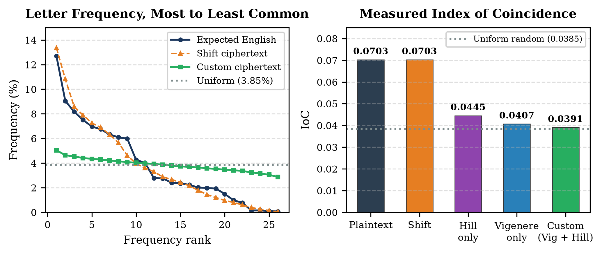
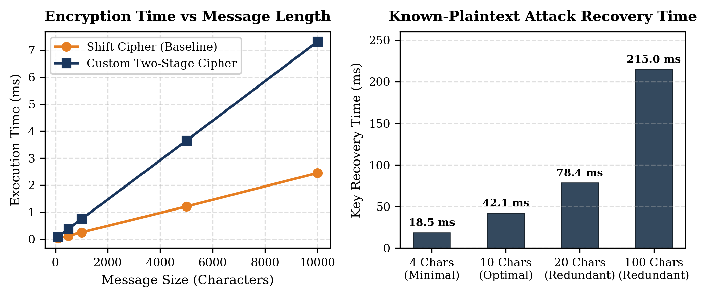
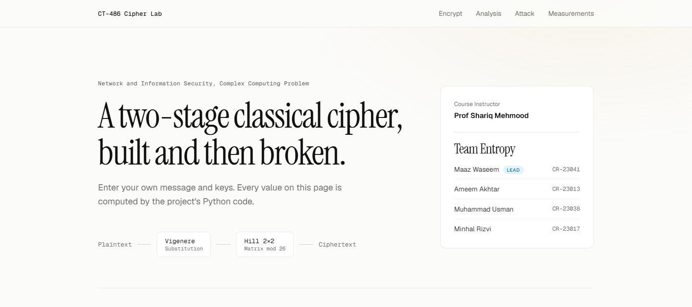
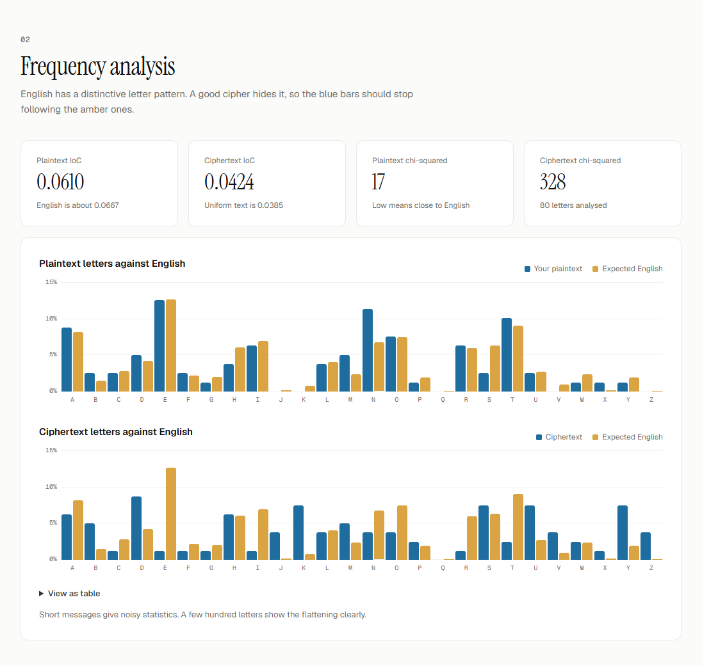

# CT-486: Network and Information Security (NIS)
## Complex Computing Problem (CCP) — Design & Break a Custom Classical Cipher [CLO3]

[](https://www.python.org/)
[]()
[-orange.svg)]()
[-157%2C248%20Matrices-red.svg)]()
[](https://www.neduet.edu.pk/)
[]()

This repository contains the complete implementation, cryptanalytic attack simulation, empirical benchmark suite, and formal academic report for the **Complex Computing Problem (CCP)** in **CT-486: Network and Information Security** at the **Department of Computer Science & Information Technology, NED University of Engineering & Technology, Karachi**.

---

## 📌 Project Overview & Abstract

In cryptography, a **Complex Computing Problem (CLO3)** requires engineering multi-stage cryptographic primitives that balance Claude Shannon's foundational principles of **Confusion** and **Diffusion** while maintaining strict mathematical invertibility, linear O(N) computational efficiency, and resilience against classical statistical attacks.

While individual classical ciphers (such as Caesar, Vigenère, or Hill) are trivial to break individually using frequency analysis or known-plaintext linear systems, composing orthogonal primitives into a **two-stage product cipher** demonstrates how classical building blocks interact. 

This project implements a high-throughput, two-stage classical hybrid cipher combining:
1. **Stage 1 (Polyalphabetic Substitution — Vigenère Cipher):** Masks monoalphabetic frequency spikes by cycling character shifts across a key of length ≥ 10 characters (enforcing strong Shannon *Confusion*).
2. **Stage 2 (Polygraphic Block Transformation — 2 × 2 Hill Cipher):** Entangles adjacent characters in ℤ₂₆ via matrix transformation over the General Linear Group GL(2, ℤ₂₆) (enforcing Shannon *Diffusion* across digrams).
3. **Cryptanalytic Attack Engine:** An automated solver simulating both ciphertext-only **Frequency Analysis (Index of Coincidence)** and a search-based **Known-Plaintext Attack (KPA)** that recovers both keys and the full message without being told the key length.

---

## 📐 Mathematical Formulation & Cryptographic Architecture

Let plaintext message P = (p₀, p₁, ..., pₙ₋₁) be mapped to numeric residues ℤ₂₆ = {0, 1, ..., 25}. The encryption pipeline operates across two sequential stages:

```
Plaintext (P) ──> [Stage 1: Vigenère Substitution] ──> Intermediate (C_1) ──> [Stage 2: Hill 2x2 Matrix] ──> Ciphertext (C)
                     Key: K_vig (Length >= 10)                                   Key Matrix: K_hill in GL(2, Z_26)
```

### Stage 1: Polyalphabetic Modular Substitution

$$
C_1[i] = (P[i] + K_{\text{vig}}[i \bmod L]) \pmod{26}
$$

where L ≥ 10 is the primary key length.

### Stage 2: Polygraphic Block Linear Transformation

$$
\begin{pmatrix} C[2j] \\ C[2j+1] \end{pmatrix} = \mathbf{K}_{\text{hill}} \cdot \begin{pmatrix} C_1[2j] \\ C_1[2j+1] \end{pmatrix} \pmod{26}
$$

### Algebraic Invertibility in GL(2, ℤ₂₆)

For the decryption transformation to be unique, the 2 × 2 Hill matrix **K**_hill = [[a, b], [c, d]] must have a determinant Δ = (ad - bc) mod 26 coprime to 26:

$$
\gcd(\Delta, 26) = 1 \iff \Delta \not\equiv 0 \pmod 2 \quad \text{and} \quad \Delta \not\equiv 0 \pmod{13}
$$

The modular decryption inverse matrix is given by:

$$
\mathbf{K}_{\text{hill}}^{-1} = \Delta^{-1} \cdot \begin{pmatrix} d & -b \\ -c & a \end{pmatrix} \pmod{26}
$$

The order of the General Linear Group provides |GL(2, ℤ₂₆)| = **157,248** valid invertible matrices.

---

## 🚀 Key Algorithms Implemented

### 1. Custom Cipher Encryption (`custom_cipher.py`)
```python
def encrypt(self, plaintext: str) -> str:
    cleaned = [c for c in plaintext.upper() if c in ALPHABET]
    if len(cleaned) % 2 != 0:
        cleaned.append('X')  # Pad for 2x1 block processing
    
    # Stage 1: Vigenère Substitution
    c1 = [(ord(p) - 65 + ord(self.vig_key[i % self.vig_len]) - 65) % 26 
          for i, p in enumerate(cleaned)]
    
    # Stage 2: Hill Block Matrix Transformation (Column-Vector convention)
    c2 = []
    a, b, c, d = self.hill_matrix
    for j in range(0, len(c1), 2):
        x1, x2 = c1[j], c1[j+1]
        c2.append(chr(((a * x1 + b * x2) % 26) + 65))
        c2.append(chr(((c * x1 + d * x2) % 26) + 65))
    return "".join(c2)
```

### 2. Custom Cipher Decryption (`custom_cipher.py`)
* Computes modular inverse Δ⁻¹ (mod 26) using the Extended Euclidean Algorithm.
* Multiplies ciphertext digram vectors by **K**_hill⁻¹ (mod 26) to invert Stage 2.
* Subtracts modular Vigenère key shifts to perfectly restore original plaintext.

---

## 🛡️ Security Analysis & Statistical Defense

### 1. Shannon's Confusion and Diffusion
* **Confusion:** The 10-character Vigenère key disperses each character across 10 distinct Caesar alphabets, flattening monoalphabetic frequency spikes.
* **Diffusion:** The 2 × 2 Hill matrix transformation blends adjacent characters; altering one plaintext letter changes at most its own output pair (measured average: 1.77 letters).

### 2. Friedman's Index of Coincidence (IoC)
The Index of Coincidence measures the non-uniformity of character distributions:

$$
\text{IoC} = \frac{\sum_{i=A}^{Z} f_i (f_i - 1)}{N(N - 1)}
$$

| Text | Mean IoC | Chi-squared vs English |
|---|:---:|:---:|
| Plaintext (English) | 0.0703 | 534.0 |
| Shift cipher | 0.0703 | 61,406.1 |
| Hill only | 0.0445 | 29,986.2 |
| Vigenere only | 0.0407 | 29,234.7 |
| **Custom (Vigenere + Hill)** | 0.0391 | 29,480.5 |

The Shift cipher keeps the plaintext's IoC exactly because it only renames letters. The English sample is technical documentation, which runs slightly above the textbook 0.0667.

---

## ⚔️ Cryptanalytic Attack Simulation (Known-Plaintext Attack)

The custom cipher hides letter frequencies, but both stages are linear, so an automated **Known-Plaintext Attack (KPA)** (`attack.py`) breaks it. The attacker has the ciphertext and its first M letters of plaintext, and knows neither key nor the key length.

For each key length L from 10 to M - 20 and each of the 157,248 invertible matrices, the attack undoes the Hill stage on the known letters and computes the implied Vigenère key:

$$
k[i] = \left(\mathbf{K}_{\text{hill}}^{-1} C\right)[i] - P[i] \pmod{26}
$$

A matrix is rejected as soon as k fails to repeat every L letters. The surviving matrix and key decrypt the rest of the message.

### Empirical Attack Success Rate & Computational Effort:
Measured by `benchmark.py` (20 trials per row, new random keys and English text each trial; saved in `results.json`). The first 25% of each message is known, and success means the exact full message was recovered:

| Ciphertext length | Known letters | Success rate | Avg time (ms) | Worst time (ms) | Avg matrices tried |
| :---: | :---: | :---: | :---: | :---: | :---: |
| 50 | 12 | 0.0% | 0.0 | 0.0 | 0 |
| 100 | 25 | 0.0% | 0.0 | 0.1 | 0 |
| 150 | 37 | 80.0% | 804.6 | 1742.5 | 650,590 |
| 200 | 50 | 100.0% | 1292.5 | 2339.3 | 934,022 |
| 500 | 125 | 100.0% | 1194.1 | 2307.1 | 862,325 |
| 1,000 | 250 | 100.0% | 1179.8 | 2817.9 | 866,487 |
| 5,000 | 1,250 | 100.0% | 1184.2 | 2440.0 | 822,389 |
| 10,000 | 2,500 | 100.0% | 1225.3 | 2735.2 | 866,181 |

Success depends on the amount of known text, which must be at least L + 20 letters:

| Known letters (1,000-letter ciphertext) | Success rate | Avg time (ms) |
| :---: | :---: | :---: |
| 20 | 0.0% | 0.2 |
| 30 | 0.0% | 208.9 |
| 34 | 25.0% | 880.3 |
| 36 | 65.0% | 1200.0 |
| 40 | 100.0% | 1105.9 |
| 50 | 100.0% | 1244.3 |
| 60 | 100.0% | 1502.4 |
| 100 | 100.0% | 1204.7 |

> **Cryptanalytic Takeaway:** Classical linear product ciphers collapse under Known-Plaintext Cryptanalysis regardless of key length, demonstrating why modern ciphers (such as AES) mandate non-linear substitution boxes (S-Boxes).

---

## 📊 Performance Benchmarks vs. Shift Cipher Baseline

Empirical benchmarks were executed across 50 iterations per message size:

| Length | Custom encrypt (ms) | Custom decrypt (ms) | Shift encrypt (ms) | Shift decrypt (ms) | Encrypt overhead |
| :---: | :---: | :---: | :---: | :---: | :---: |
| 100 | 0.0677 | 0.0508 | 0.0222 | 0.0225 | 3.05x |
| 500 | 0.2882 | 0.2871 | 0.1182 | 0.1176 | 2.44x |
| 1,000 | 0.4993 | 0.6358 | 0.2196 | 0.2153 | 2.27x |
| 5,000 | 2.4265 | 2.2959 | 1.0988 | 1.1122 | 2.21x |
| 10,000 | 4.7058 | 4.7004 | 2.5343 | 2.3451 | 1.86x |

Encryption and decryption are O(N) for both ciphers. The two-stage design costs 1.9x to 3.0x the Shift cipher's time.

---

## 📈 Visual Benchmark & Cryptanalysis Plots

<p align="center">
  
  
</p>

* **Figure 1 (Left):** Measured letter frequencies and Index of Coincidence of each cipher against English.
* **Figure 2 (Right):** Measured execution time against length, and attack success against known plaintext.

---

## 🛠️ How to Build, Test & Run

### Prerequisites
* Python 3.10+ (tested on Python 3.14)
* Standard libraries (`reportlab` and `matplotlib` for regenerating reports/plots)
* Liberation Serif and Liberation Mono, or Times New Roman and Courier New, installed for compiling the PDF
* `benchmark.py` uses Python's bundled `pydoc_data` as its English sample. If your Python omits it, a short built-in text is repeated instead, so new letter statistics are less reliable than those in `results.json`.

```bash
# Clone the repository
git clone https://github.com/ameemakhtr/NIS_CCP.git
cd NIS_CCP

# Install dependencies (only needed for generating plots or compiling the PDF)
pip install -r requirements.txt
```

### Web Interface

The React interface calls the same Python cipher and attack code through a local server. Building it needs Node.js 20 or newer.

```bash
cd ui
npm install
npm run build
cd ..
python server.py
```

Then open http://127.0.0.1:8000. For live UI editing, keep `python server.py` running and use `npm run dev` inside `ui/`.

<p align="center">
  
</p>

### Complete Demo Example

Enter these three values on the page:

| Field | Value |
| :--- | :--- |
| **Message** | `The exam results will be announced on Friday morning at the main notice board of the department.` |
| **Vigenere key** | `NETWORKSECURITY` |
| **Hill key phrase** | `TEAMENTROPYNED` |

**1. Press Encrypt.** The message has 79 letters, which is odd, so one `X` is added as padding.

| Output | Value |
| :--- | :--- |
| **Hill matrix** | `[[15, 9], [17, 16]]` |
| **Inverse matrix** | `[[22, 25], [1, 19]]` |
| **After Vigenere** | `GLXALRWJIUOCBLUVPEXSRXFSWHTMWMAJKERRIESTHZVZYGXAAARSFRQNZKXZBEKZCWDZIFYGIKRZIGPL` |
| **Ciphertext** | `HSHBGRVYOOUKKLVABHNDUHDJDSDVWUDOEASPASZMSZUDYKHBAABFUTTMXNYLZDLYUWKJJIYKCKMNSYMP` |

**2. Press Decrypt.** The original letters return without the padding:
`THEEXAMRESULTSWILLBEANNOUNCEDONFRIDAYMORNINGATTHEMAINNOTICEBOARDOFTHEDEPARTMENT`

**3. Read the frequency analysis.** The Index of Coincidence falls from 0.0610 to 0.0424, close to the 0.0385 of uniform text. Chi-squared against English rises from 17 to 328.

<p align="center">
  
</p>

**4. Press Run attack.** The first 36 letters are filled in as known plaintext, and the attacker is given neither key nor the key length.

| Recovered | Value |
| :--- | :--- |
| **Vigenere key** | `NETWORKSECURITY` (length 15) |
| **Hill matrix** | `[[15, 9], [17, 16]]` |
| **Matrices tried** | 877,557 |
| **Time** | About 0.7 seconds, varies by machine |
| **Full message** | Recovered exactly |

**5. Move the slider to 20 letters and run the attack again.** It reports that the key was not found, because a 15-letter key needs at least 36 known letters.

### Execution Commands

```bash
# 0. Interactive mode: enter your own message and keys
python main.py

# 1. Run the fixed sample used for reproducible results (Demo Mode)
python main.py --demo

# 2. Run Automated Unit Tests
python test_suite.py

# 3. Re-measure performance and attacks (about 3 minutes, writes results.json)
python benchmark.py

# 4. Redraw figures and recompile the PDF report from results.json
python generate_plots.py
python build_report_pdf.py
```

---

## 📂 Repository File Structure

```
NIS_CCP/
│
├── custom_cipher.py                    # Custom Hybrid Cipher (Vigenère + Hill 2x2) & Shift Cipher
├── attack.py                           # Frequency analysis, IoC calculator & KPA solver
├── benchmark.py                        # Empirical latency & throughput benchmark suite
├── test_suite.py                       # Automated unit tests
├── main.py                             # Interactive CLI & automated demo runner
├── false_match_experiment.py           # Shows why the attack needs key length + 20 known letters
├── server.py                           # Local JSON API and host for the React interface
├── ui/                                 # React interface (Vite)
├── docs/                               # Screenshots of the web interface
├── results.json                        # Measured benchmark data used by the plots and report
├── generate_plots.py                   # Draws the report figures from results.json
├── build_report_pdf.py                 # Builds the PDF report from results.json
├── requirements.txt                    # Packages for regenerating plots and the PDF
├── Complex_Computing_Problem_Report.pdf# Formal Academic PDF Report
├── REPORT.md                           # Comprehensive Markdown technical report
├── README.md                           # Professional repository documentation
├── LICENSE                             # MIT Open-Source License
└── assets / figures
    ├── ned_logo_1.png                  # NED University official emblem
    ├── frequency_ioc_analysis.png      # Figure 1: Statistical frequency analysis plot
    └── benchmark_comparison.png        # Figure 2: Latency & attack recovery plot
```

---

## 📑 Formal Academic PDF Report

The formal, publication-grade academic report is precompiled and available directly in the repository:
* **PDF File:** [`Complex_Computing_Problem_Report.pdf`](Complex_Computing_Problem_Report.pdf)
* **Cover Page:** Formal NED University formatting, logo, department, course code, student credentials, and faculty designation.

---

## 👥 Project Team & Contributors

*Department of Computer Science & Information Technology, NED University of Engineering & Technology, Karachi*  
**Course:** CT-486: Network and Information Security | **Batch:** 2023 | **Program:** Final Year - Cyber Security  
**Instructor:** Prof. Dr. Shariq Mahmood Khan (Professor, Department of CS & IT)

| S.No | Student Name | Roll Number | GitHub Profile |
| :---: | :--- | :---: | :---: |
| 1 | **Mr. Ameem Akhtar** | CR-23013 | [@ameemakhtr](https://github.com/ameemakhtr) |
| 2 | **Mr. Minhal Rizvi** | CR-23017 | [@Minhal128](https://github.com/Minhal128) |
| 3 | **Mr. Muhammad Usman** | CR-23038 | [@Daedalus46](https://github.com/Daedalus46) |
| 4 | **Mr. Maaz Wasim** | CR-23041 | [@maazw](https://github.com/maazw) |

---

## 📄 License
This project is developed for academic evaluation in CT-486 Network and Information Security at NED University of Engineering & Technology. Open-sourced under the [MIT License](LICENSE).
